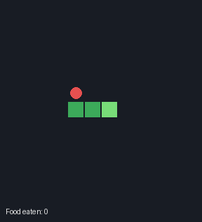
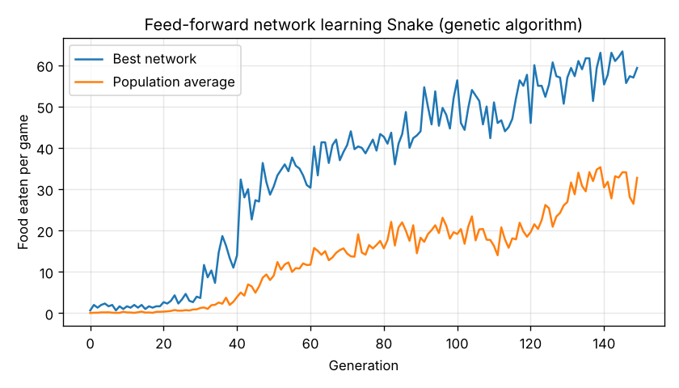
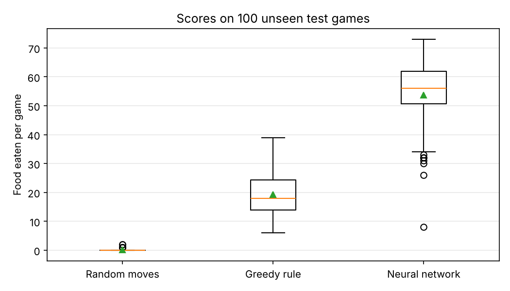

# Snake played by a feed-forward neural network

A small feed-forward neural network, written in plain NumPy, that learns to play Snake. The network is trained with a genetic algorithm (neuroevolution), with no backpropagation and no game-specific rules.



## About this project

This repository re-creates the topic of my **MSc Computer Science dissertation at the University of East London (2023)**: a feed-forward neural network that learns to play Snake. The original 2023 code was not kept, so this is a new, clean implementation written in 2026. I rebuilt it from scratch to show the approach and to make the results reproducible.

## Results

Tested on **100 new games the network never saw during training** (12 x 12 board). All agents play the same 100 games.

| Agent | Average food per game | Median | Best game |
|---|---|---|---|
| **Trained neural network** | **53.7** | 56 | 73 |
| Greedy rule (head straight for the food, avoid instant crashes) | 19.3 | 18 | 39 |
| Random moves | 0.1 | 0 | 2 |

The network beats the greedy rule in **97 of 100 games**, even though both use exactly the same 11 inputs.



**Repeatable:** three independent training runs (seeds 42, 7 and 123) reach test averages of 53.7, 45.1 and 48.9.



**Main weakness:** 99 of the 100 test games end with the snake running into its own body. It only senses the cells next to its head, so it cannot see when it is enclosing itself.

All numbers come from `results/analysis.json`. They are produced by the scripts below and can be reproduced exactly with the fixed random seeds.

**Full write-up:** see the technical report `report/Snake_Neural_Network_Thesis_Krishna_Kumar_Thummala.pdf` (18 pages: literature review, method, experiments, discussion).

## How it works

**1. The game** (`snake/game.py`)
A headless 12 x 12 Snake game. The snake dies if it hits a wall or itself, or if it goes too long without eating, so a bad agent cannot loop forever.

**2. What the network sees**: 11 simple inputs
- Danger straight ahead, to the right, to the left (3)
- Current direction, one-hot (4)
- Food is to the left, right, above or below the head (4)

**3. The network** (`snake/network.py`)
`11 inputs → 16 hidden neurons (ReLU) → 3 outputs`. The outputs are *keep going*, *turn right* and *turn left*, and the highest one is chosen. That's 243 weights in total.

**4. Training: genetic algorithm** (`train.py`)
- A population of 120 networks with random weights.
- Each network plays 3 games and gets a fitness score: food eaten counts most, survival time a little.
- The top 10 networks are kept unchanged (elitism).
- New networks are made by mixing the weights of two good parents (uniform crossover) and adding small random changes (mutation).
- The games are new every generation, so networks must learn a general strategy, not memorise one board.

## Run it yourself

```bash
pip install -r requirements.txt
python train.py --generations 150   # about 5 minutes on a laptop CPU
python evaluate.py                  # test on 100 unseen games, make the chart and GIF
python baselines.py                 # greedy rule baseline
python analysis.py                  # all tables and figures in the report
```

## What I learned

- **Simple inputs can be enough.** Eleven well-chosen features let a tiny network play well. Feature design mattered more than network size.
- **Fitness design shapes behaviour.** Food is worth far more than survival time in the fitness score. If survival is rewarded too much, an agent can learn to circle safely instead of hunting, and the game's no-food time limit guards against this too.
- **Test on unseen data.** Using new random games every generation, and separate seeds for the final test, shows the agent learned a general skill.
- **Limits.** The agent only sees one cell ahead, so long snakes trap themselves (99 of 100 test games end this way). Giving it a view of its own body, or training with reinforcement learning (for example a DQN), are natural next steps.

## Project structure

```
snake/game.py        Snake game and the 11 input features
snake/network.py     Feed-forward network in NumPy
train.py             Genetic-algorithm training
evaluate.py          Test on unseen games, chart and GIF
baselines.py         Greedy rule baseline
analysis.py          Seeds, baselines, failure analysis, figures
results/             Trained weights (JSON), histories, results, figures, GIF
report/              Technical report (Word/PDF) and the script that builds it
```

## Author

Krishna Kumar Thummala · MSc Computer Science, University of East London
[linkedin.com/in/kumar623](https://linkedin.com/in/kumar623) · [thummala.dev](https://thummala.dev)
